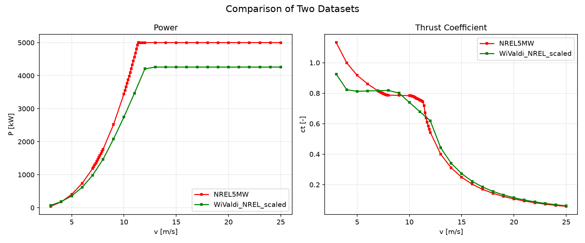

Wind Turbine Model
=====================

.. _turbine:

Due to confidentiality, the exact WiValdi turbine model including information about blade geometry and control strategy cannot be provided to the IEA community.
Our goal is to provide a substitute model which can be publicly shared and has similar characteristics in terms of wake generation as observed at WiValdi.
As a basis for an open model we choose the NREL-5MW wind turbine. It compares to the WiValdi Enercon E115 EP3 E4 in the following way for the basic parameters:

.. list-table:: Wind Turbine Comparison
   :widths: 30 35 35
   :header-rows: 1

   * - Characteristic
     - NREL 5-MW Reference Turbine
     - Enercon E-115, EP3 E4
   * - Rated Power
     - 5.0 MW
     - 4.26 MW
   * - Rotor Diameter
     - 126 m
     - 115.7 m
   * - Rated Wind Speed
     - 11.4 m/s
     - 13.2 m/s
   * - Typical Hub Heights
     - 90 m (onshore)
     - 92 m

To adapt the NREL-5MW benchmark turbine to WiValdi characteristics, we have the following goals:

- **Rotor diameter** and **hub height** should match
- The generated **electrical power** should match
- The **rated wind speed** should be within 0.5 m/s
- The **thrust coefficient** in the partial load regime should match estimated values of ~0.8
- A **consistent model** for LES ADM/ALM models and engineering models must be provided

To achieve these goals, the following measures are taken:
 - **Geometrical scaling** of the rotor geometry from rotor diameter 126 m down to 116 m (see details below).
 - Run **Bladed simulations** to match power and thrust target values through adjustments of:
  - Pitch over wind speed curve
  - RPM over wind speed curve
  - Maximum rotor RPM
  - Electrical efficiency

In the following the geometrical scaling is explained in detail:

WiValdi scaled version of the NREL-5MW turbine for ADM/ALM-LES
~~~~~~~~~~~~~~~~~~~~~~~~

Here, a description of the model files is given.

1. **WiValdi_scaled_NREL5MW.geo**

This files contains Information of

- r = radial position in [m]
- r_blade = radial position in [m] - r_nac
- twist = twist angle in [deg]
- chord = chord length in [m]
- t = thickness in [m]

Scaled rotor geometry (R = 58 m, hub radius = 2.42 m from Enercon E-115 turbine))

.. list-table::
   :header-rows: 1
   :widths: 8 17 15 15 15 15

   * - Node
     - r [m]
     - r_blade [m]
     - twist [deg]
     - chord [m]
     - thickness [m]
   * - 1
     - 2.755586
     - 1.255586
     - 13.308
     - 3.260889
     - 3.260889
   * - 2
     - 5.266667
     - 3.766667
     - 13.308
     - 3.548127
     - 3.134347
   * - 3
     - 7.777747
     - 6.277747
     - 13.308
     - 3.836286
     - 2.459337
   * - 4
     - 10.916667
     - 9.416667
     - 13.308
     - 4.195333
     - 1.708341
   * - 5
     - 14.683333
     - 13.183333
     - 11.480
     - 4.282794
     - 1.498977
   * - 6
     - 18.450000
     - 16.950000
     - 10.162
     - 4.104190
     - 1.325965
   * - 7
     - 22.216667
     - 20.716667
     - 9.011
     - 3.911778
     - 1.173533
   * - 8
     - 25.983333
     - 24.483333
     - 7.795
     - 3.688984
     - 0.986533
   * - 9
     - 29.750000
     - 28.250000
     - 6.544
     - 3.450540
     - 0.828738
   * - 10
     - 33.516667
     - 32.016667
     - 5.361
     - 3.224063
     - 0.709358
   * - 11
     - 37.283333
     - 35.783333
     - 4.188
     - 2.997587
     - 0.593075
   * - 12
     - 41.050000
     - 39.550000
     - 3.125
     - 2.771111
     - 0.498800
   * - 13
     - 44.816667
     - 43.316667
     - 2.319
     - 2.544635
     - 0.458034
   * - 14
     - 48.583333
     - 47.083333
     - 1.526
     - 2.318159
     - 0.417268
   * - 15
     - 51.722253
     - 50.222253
     - 0.863
     - 2.129429
     - 0.383297
   * - 16
     - 54.233333
     - 52.733333
     - 0.370
     - 1.920444
     - 0.345678
   * - 17
     - 56.744414
     - 55.244414
     - 0.106
     - 1.306381
     - 0.235149

Detailed geometric scaling of the NREL 5-MW reference turbine

The original NREL 5-MW blade geometry is scaled to the Enercon rotor
diameter of 115.7 m (rounded to 116 m, nacelle radius of 1.5 m).

A detailed description of the scaling procedure is given below:

Original NREL 5-MW reference blade geometry

.. list-table::
   :header-rows: 1
   :widths: 5 9 14 11 10 11 11 10 10 11 12 17

   * - Node
     - r_old [m]
     - r_blade_old [m]
     - r/R_old
     - dr_old [m]
     - dr/R_old
     - xi
     - twist [deg]
     - c_old [m]
     - c/R_old
     - t_old [m]
     - Airfoil
   * - 1
     - 2.8667
     - 1.3667
     - 0.045503175
     - 2.7333
     - 0.043385714
     - 0.022222764
     - 13.308
     - 3.542
     - 0.056222222
     - 3.5419999
     - Cylinder1.dat
   * - 2
     - 5.6000
     - 4.1000
     - 0.088888889
     - 2.7333
     - 0.043385714
     - 0.066666667
     - 13.308
     - 3.854
     - 0.061174603
     - 3.4045491
     - Cylinder1.dat
   * - 3
     - 8.3333
     - 6.8333
     - 0.132274603
     - 2.7333
     - 0.043385714
     - 0.111110569
     - 13.308
     - 4.167
     - 0.066142857
     - 2.6713484
     - Cylinder2.dat
   * - 4
     - 11.7500
     - 10.2500
     - 0.186507937
     - 4.1000
     - 0.065079365
     - 0.166666667
     - 13.308
     - 4.557
     - 0.072333333
     - 1.8556114
     - DU40_A17.dat
   * - 5
     - 15.8500
     - 14.3500
     - 0.251587302
     - 4.1000
     - 0.065079365
     - 0.233333333
     - 11.480
     - 4.652
     - 0.073841270
     - 1.6281994
     - DU35_A17.dat
   * - 6
     - 19.9500
     - 18.4500
     - 0.316666667
     - 4.1000
     - 0.065079365
     - 0.300000000
     - 10.162
     - 4.458
     - 0.070761905
     - 1.4402727
     - DU35_A17.dat
   * - 7
     - 24.0500
     - 22.5500
     - 0.381746032
     - 4.1000
     - 0.065079365
     - 0.366666667
     - 9.011
     - 4.249
     - 0.067444444
     - 1.2746991
     - DU30_A17.dat
   * - 8
     - 28.1500
     - 26.6500
     - 0.446825397
     - 4.1000
     - 0.065079365
     - 0.433333333
     - 7.795
     - 4.007
     - 0.063603175
     - 1.0715794
     - DU25_A17.dat
   * - 9
     - 32.2500
     - 30.7500
     - 0.511904762
     - 4.1000
     - 0.065079365
     - 0.500000000
     - 6.544
     - 3.748
     - 0.059492063
     - 0.90018093
     - DU25_A17.dat
   * - 10
     - 36.3500
     - 34.8500
     - 0.576984127
     - 4.1000
     - 0.065079365
     - 0.566666667
     - 5.361
     - 3.502
     - 0.055587302
     - 0.77050973
     - DU21_A17.dat
   * - 11
     - 40.4500
     - 38.9500
     - 0.642063492
     - 4.1000
     - 0.065079365
     - 0.633333333
     - 4.188
     - 3.256
     - 0.051682540
     - 0.64420168
     - DU21_A17.dat
   * - 12
     - 44.5500
     - 43.0500
     - 0.707142857
     - 4.1000
     - 0.065079365
     - 0.700000000
     - 3.125
     - 3.010
     - 0.047777778
     - 0.54179962
     - NACA64_A17.dat
   * - 13
     - 48.6500
     - 47.1500
     - 0.772222222
     - 4.1000
     - 0.065079365
     - 0.766666667
     - 2.319
     - 2.764
     - 0.043873016
     - 0.49751958
     - NACA64_A17.dat
   * - 14
     - 52.7500
     - 51.2500
     - 0.837301587
     - 4.1000
     - 0.065079365
     - 0.833333333
     - 1.526
     - 2.518
     - 0.039968254
     - 0.45323955
     - NACA64_A17.dat
   * - 15
     - 56.1667
     - 54.6667
     - 0.891534921
     - 2.7333
     - 0.043385714
     - 0.888889431
     - 0.863
     - 2.313
     - 0.036714286
     - 0.41633933
     - NACA64_A17.dat
   * - 16
     - 58.9000
     - 57.4000
     - 0.934920635
     - 2.7333
     - 0.043385714
     - 0.933333333
     - 0.370
     - 2.086
     - 0.033111111
     - 0.37547794
     - NACA64_A17.dat
   * - 17
     - 61.6333
     - 60.1333
     - 0.978306349
     - 2.7333
     - 0.043385714
     - 0.977777236
     - 0.106
     - 1.419
     - 0.022523810
     - 0.25542000
     - NACA64_A17.dat

The original NREL and new Enercon turbine parameters of the radius of the nacelle and the rotor R as well as the blade length L are:

.. math::

   R_{\mathrm{old}} = 63\,\mathrm{m}

   r_{\mathrm{hub,old}} = 1.5\,\mathrm{m}

   L_{\mathrm{old}} = 61.5\,\mathrm{m}

   R_{\mathrm{new}} = 58\,\mathrm{m}

   r_{\mathrm{hub,new}} = 1.5\,\mathrm{m}

   L_{\mathrm{new}} = 56.5\,\mathrm{m}

**Normalized blade position:**

The normalized blade position is defined as

.. math::

   \xi = \frac{r_{\mathrm{old}} - r_{\mathrm{hub,old}}}
   {L_{\mathrm{old}}}

The new radial position is calculated as

.. math::

   r_{\mathrm{new}} = r_{\mathrm{hub,new}}
   + \xi L_{\mathrm{new}}

**Chord length:**

The chord length is scaled proportionally to the new rotor radius.
The normalized chord length remains unchanged:

.. math::

   c_{\mathrm{new}}
   = \left(\frac{c}{R}\right)_{\mathrm{old}}
   R_{\mathrm{new}}

**Airfoil thickness:**

The airfoil thickness is scaled proportionally to the new rotor radius.

.. math::

   t_{\mathrm{new}} = \left(\frac{t}{R}\right)_{\mathrm{old}}
   R_{\mathrm{new}}

**Blade segment width:** 

The blade segment widths are scaled according to the ratio of the
new and original blade lengths:

.. math::

   dr_{\mathrm{new}}
   = dr_{\mathrm{old}}
   \frac{L_{\mathrm{new}}}{L_{\mathrm{old}}}

**Twist angle:**

The twist angle is kept unchanged:

.. math::

   twist_{\mathrm{new}} = twist_{\mathrm{old}}

-------------------------------------

2. **WiValdi_scaled_NREL5MW.cl**

- first row:
	- 0 can be ignored
	- rest: r/R scaled radial positions along the blade, dimensionless, for the Enercon E-115 scaled rotor (R=58m, hub radius=2.42m), detailed description below
	- The corresponding airfoil starts at the value of r/R and is valid until the next value of r/R in the next column is reached.

**Scaling of Airfoil Activation Regions**

The lift and drag coefficient polars (cl and cd) of the original NREL
5-MW reference turbine remain unchanged. Only the radial regions in
which the individual airfoils are active are adjusted to account for
the scaled rotor radius and hub radius.

The original rotor has a radius of 63 m and a hub radius of 1.5 m.
The scaled rotor has a radius of 58 m and a hub radius of 2.42 m.

The original airfoil boundaries are scaled by preserving their
normalized position along the blade span. The normalized blade
position is defined as

.. math::

   \xi = \frac{r_{\mathrm{old}} - r_{\mathrm{hub,old}}}
   {R_{\mathrm{old}} - r_{\mathrm{hub,old}}}

The corresponding radial position on the scaled rotor is

.. math::

   r_{\mathrm{new}} = r_{\mathrm{hub,new}}
   + \xi \left( R_{\mathrm{new}} - r_{\mathrm{hub,new}} \right)

The normalized radial position used in the ``.cl`` and ``.cd`` files
is then calculated as

.. math::

 \frac{r_{\mathrm{new}}}{R_{\mathrm{new}}}

The original and scaled airfoil activation regions are listed below.
Each airfoil is active from its starting radius up to the starting
radius of the next airfoil. The final NACA64 airfoil extends to the
rotor tip.

Airfoil Activation Regions

.. list-table::
   :header-rows: 1
   :widths: 15 45 45 65 65

   * - Airfoil
     - Original active range [m]
     - Scaled active range [m]
     - Original r/R
     - Scaled r/R
   * - Cylinder1
     - 1.500 -- 6.967
     - 1.500 -- 6.523
     - 0.023810 - 0.110582
     - 0.025862 - 0.112136
   * - Cylinder2
     - 6.967 -- 9.700
     - 6.523 -- 9.033
     - 0.110582 - 0.153968
     - 0.112136 - 0.155747
   * - DU40
     - 9.700 -- 13.800
     - 9.033 -- 12.800
     - 0.153968 - 0.219048
     - 0.155747 - 0.220690
   * - DU35
     - 13.800 -- 22.000
     - 12.800 -- 20.333
     - 0.219048 - 0.349206
     - 0.220690 - 0.350575
   * - DU30
     - 22.000 -- 26.100
     - 20.333 -- 24.100
     - 0.349206 - 0.414286
     - 0.350575 - 0.415517
   * - DU25
     - 26.100 -- 34.300
     - 24.100 -- 31.633
     - 0.414286 - 0.544444
     - 0.415517 - 0.545402
   * - DU21
     - 34.300 -- 42.500
     - 31.633 -- 39.167
     - 0.544444 - 0.674603
     - 0.545402 - 0.675287
   * - NACA64
     - 42.500 -- 63.000
     - 39.167 -- 58.000
     - 0.674603 - 1.00000
     - 0.675287 - 1.00000

The first row of the ``.cl`` and ``.cd`` files contains a leading zero,
followed by the scaled normalized starting positions of the airfoils.
The aerodynamic coefficients themselves are not rescaled or modified.

-------------------------------------

3. **WiValdi_scaled_NREL5MW.cd**

same as WiValdi_scaled_NREL5MW.cl, the other columns represent now the cd values.

-------------------------------------

4. **WiValdi_scaled_NREL5MW.vel**

This file contains velocity dependent information (cutin and cutout wind speed)

- The first column is the wind speed in m/s.
- The second column is the rpm related to the corresponding wind speed.
- The third column is the pitch angle related to the corresponding wind speed.

--------------------------------------

Thrust and power curve of the WiValdi benchmark turbine
~~~~~~~~~~~~~~~~~~~~~~~~

After scaling and tuning, the output of aeroelastic simulations with the commercial tool DNV Bladed for the power- and thrust-curve are as follows in comparison to the original NREL-5MW turbine:

The tabular values for the range of values in the different benchmark cases are given in the WiValdi_setup.json files in the respective Zenodo databse.

